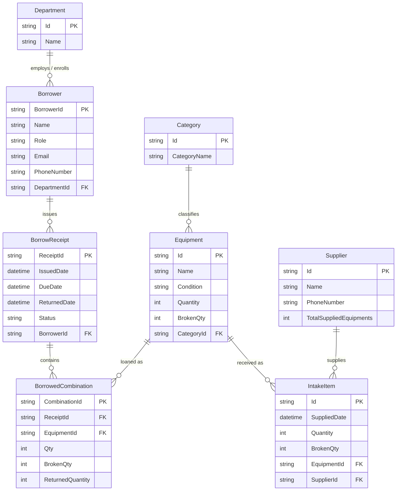

# QA Technical Audit: Project Architecture Analysis

**Project Name:** Sport Room Management System (Project Sport Room)  
**Audit Date:** 2026-11-05  
**Auditor:** QA Technical Specialist & .NET Software Architect  
**Status:** Baseline Discovery Completed  

---

## 1. Executive Summary & Technology Stack

| Component | Detail |
|---|---|
| **IDE & Tooling** | Visual Studio 2022 / .NET SDK 8.0 |
| **Language** | C# 12 (`<Nullable>enable</Nullable>`, `<ImplicitUsings>enable</ImplicitUsings>`) |
| **UI Framework** | Windows Forms (WinForms), DPI-aware, STAThread |
| **Target Runtime** | .NET 8.0 Windows (`net8.0-windows`) |
| **ORM Framework** | Entity Framework Core 8.0.22 |
| **Database Provider**| SQLite (`Microsoft.EntityFrameworkCore.Sqlite` 8.0.22) |
| **Database File** | `sportroom.db` (Local SQLite relational file) |
| **Architecture Pattern**| Direct UI-to-DbContext (Two-Tier Desktop Client) |

---

## 2. Solution Structure & Module Inventory

The solution consists of:
- `Project Sport Room.sln`
- `Project Sport Room/Project Sport Room.csproj`

```
Project Sport Room/
├── Program.cs                     (Application entry point)
├── sportroom.db                   (SQLite Relational Database)
├── Forms/                         (WinForms UI Layer)
│   ├── Form1                      (Main Navigation Shell / Host Container)
│   ├── OverviewForm               (System KPI Dashboard & Transaction Monitor)
│   ├── InventoryForm              (Equipment Stock Management & Categorization)
│   ├── Add                        (Master Setup Dialog: Supplier, Category, Equipment)
│   ├── SupplierForm               (Supplier Registry & Intake History Dashboard)
│   ├── manageSupplier             (Supplier Edit & Intake Modification Dialog)
│   ├── newIntake                  (Intake Records & Supplier Quick View)
│   ├── addNewIntake               (Batch Intake Entry Form)
│   ├── BorrowerForm               (Borrower Registry & Transaction Dashboard)
│   ├── addBorrowers               (New Loan / Receipt Creation Dialog)
│   ├── manageBorrower             (Borrower Profile & Receipt Adjustment Dialog)
│   └── borrwedEquipment           (Placeholder / Unlinked UI Skeleton)
├── Models/                        (Entity Framework Core Entities)
│   ├── SportRoomContext.cs        (Main EF Core DbContext)
│   ├── Department.cs              (Academic Department Entity)
│   ├── Category.cs                (Equipment Category Entity)
│   ├── Equipment.cs               (Sport Equipment Catalog Entity)
│   ├── Supplier.cs                (Equipment Supplier Entity)
│   ├── IntakeItem.cs              (Inward Equipment Supply Batch Item)
│   ├── Borrower.cs                (Student & Staff Borrower Entity)
│   ├── BorrowReceipt.cs           (Loan Transaction Header)
│   └── BorrowedCombination.cs     (Loan Transaction Line Item)
└── Migrations/                    (EF Core Database Migrations)
    └── 20261103131459_InitialSetup.cs
```

---

## 3. Module Breakdown & Navigation Workflow

### Module 1: Navigation Host (`Form1`)
- Acts as a master workspace embedding non-top-level borderless child forms into `MainPanel`.
- Caches form instances (`_overviewForm`, `_inventoryForm`, `_newIntakeForm`, `_borrowerForm`, `_supplierForm`).
- Triggers child form display and refresh via `VisibleChanged` / `Activated` events.

### Module 2: Executive Overview (`OverviewForm`)
- Displays real-time aggregate inventory KPIs (Total Equipment, Available Healthy, Damaged, Currently Borrowed, Newly Arrived within 30 days).
- Multi-criteria grid filtering: Global text search, Department dropdown with "ALL" support, and Status filtering ("All", "Borrowed", "Overdue", "Returned", "Returned Late").
- Dynamic status calculation evaluated at projection time.

### Module 3: Inventory Management (`InventoryForm`)
- Live equipment breakdown: Unique types count, total physical units, healthy units, damaged units.
- Real-time search by ID/Name and Category filtering.
- Displays healthy vs broken inventory counts.

### Module 4: Catalog & Master Setup (`Add`)
- Modal dialog for adding:
  1. Suppliers (Name, Phone number).
  2. Categories (Category Name).
  3. Equipment (Name, Category link).
- Auto-generates unique business IDs with prefixes (`SUPP_`, `CTGR_`, `EQP_`).

### Module 5: Supplier Registry & History (`SupplierForm`, `manageSupplier`)
- `SupplierForm`: Left-side supplier selection list, summary KPI cards (total supplied units), date-range filtering, and intake history grid.
- `manageSupplier`: Modal dialog to edit supplier contact info, modify intake line quantities, restock or adjust equipment units, and delete intake history with optional stock rollback.

### Module 6: Equipment Intake Workflow (`newIntake`, `addNewIntake`)
- `newIntake`: Overview of intake batches and supplier records, launching `Add` or `addNewIntake`.
- `addNewIntake`: Cart-style batch intake workflow allowing multi-item entry under a single supplier, updating both master stock and logging intake records.

### Module 7: Borrower & Loan Transaction Management (`BorrowerForm`, `addBorrowers`, `manageBorrower`)
- `BorrowerForm`: Main lending workspace. Displays borrower list, profile summary, receipt history, in-place return date picker popup, return checkmark toggle with automatic stock replenishment.
- `addBorrowers`: Form for issuing new equipment loans. Validates stock availability before checkout, deducts borrowed units from master equipment stock, and creates `BorrowReceipt` + `BorrowedCombination` records.
- `manageBorrower`: Profile management dialog for borrower details, loan adjustments, and receipt corrections.

---

## 4. Entity-Relationship (ER) Architecture



---

## 5. Architectural Findings, Smells & Risks

1. **Direct UI-to-Database Coupling:**
   - Business calculations (stock calculation, loan duration rules, return status, KPI aggregations) are embedded directly inside WinForms event handlers.
   - Recommend extracting pure calculation methods into domain/service helpers so they can be thoroughly unit tested and reused across forms.

2. **Inconsistent DbContext Lifetimes:**
   - Most forms use clean, short-lived `using (var db = new SportRoomContext())` blocks.
   - `manageBorrower` maintains a class-level `_db` instance field that lives for the life of the form. This introduces risk of stale entity state, tracking collisions, and concurrency errors if multiple windows open.

3. **Database Transaction Boundaries:**
   - In `addBorrowers` and `manageSupplier`, multi-step updates (deducting master equipment inventory while inserting or updating line items) rely on EF Core implicit transactions during `SaveChangesAsync`. If any validation fails mid-way, errors must be handled consistently.

4. **Foreign Key Schema Inconsistency:**
   - In `BorrowedCombination.cs`, `ReceiptId` lacks explicit `[ForeignKey("BorrowReceipt")]` or Fluent API mapping, causing EF Core to scaffold a shadow property `BorrowReceiptReceiptId`.

5. **Nullability & String Safety:**
   - LINQ queries projecting `data.Supplier.Name` without checking if `Supplier` is null (since `SupplierId` is nullable).
   - In `SupplierForm.cs`: `phoneNumaber.Text = supplierData.FirstOrDefault().PhoneNumber ?? ""` will throw `NullReferenceException` if `supplierData` is empty.

6. **Error Handling & Silent Swallowing:**
   - `SupplierForm.cs` line 42 & 94 contains `catch (Exception ex) { }` silently ignoring database errors.
   - `Add.cs` line 49 contains `catch { }` silently ignoring load failures.

